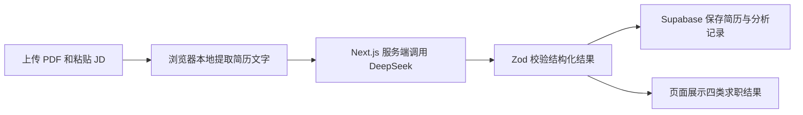

# 职达 AI · 求职助手

> 上传一份简历，粘贴一个目标岗位，让 AI 帮你完成岗位匹配分析、简历优化、定向求职信和面试准备。

## 在线网站

**[立即体验职达 AI](https://zhida-ai-career-assistant.netlify.app)**

| 服务 | 用途 |
| --- | --- |
| **Netlify** | 网站托管、Next.js Runtime、服务端函数、GitHub 持续部署 |
| **Supabase** | 邮箱登录、用户资料、PostgreSQL 数据库、RLS 数据隔离 |
| **DeepSeek** | 岗位分析、简历建议、求职信和面试问答生成 |
| **PDF.js** | 在浏览器本地提取 PDF 简历文字，不上传原 PDF |

---

## 已实现功能

### 求职者功能

- 上传文本型 PDF 简历，支持文件大小、页数和文字长度校验；
- 在浏览器中完成 PDF 文字提取，可查看提取结果；
- 粘贴目标岗位 JD，生成四类结果：
  1. 岗位匹配度、匹配优势与主要差距；
  2. 5–8 条具体简历优化建议；
  3. 一封针对岗位的求职信；
  4. 10 个面试问题、考察意图、参考回答和准备提示；
- 分项复制或复制完整报告；
- 桌面端与移动端响应式界面。

### 游客模式

- 无需注册或登录；
- 原 PDF 只在浏览器中解析，不上传到服务器；
- 简历文字和 JD 仅在点击分析后发送给本站服务端与 DeepSeek；
- 分析结果只保存在当前页面内存，刷新后清除；
- 不向 Supabase 写入求职数据。

### 登录模式

- 使用 Supabase Auth 邮箱注册、登录和退出；
- 首次登录访问时自动创建 `profiles` 用户资料；
- 用户自行决定是否开启“保存本次分析到历史”；
- 开启后保存简历解析文字、简历版本、JD、分析报告和 Token 用量；
- 查看历史报告列表与详情；
- 删除单条报告，或清空当前用户的全部保存数据；
- **当前不上传原 PDF，也不使用 Supabase Storage。**

---

## 技术栈

| 层级 | 技术 |
| --- | --- |
| 前端 | Next.js 16、React 19、TypeScript、原生 CSS、Lucide Icons |
| PDF 处理 | `pdfjs-dist` + Web Worker |
| 服务端 | Next.js App Router Route Handlers |
| AI 输出校验 | Zod + 自定义 JSON 结果契约 |
| 身份认证 | Supabase Auth + `@supabase/ssr` |
| 数据库 | Supabase PostgreSQL + Row Level Security |
| 部署 | Netlify Next.js Runtime + GitHub Continuous Deployment |

---

## 功能是如何实现的

### 1. 完整分析流程



### 2. PDF 在浏览器本地解析

`lib/pdf.ts` 使用 `pdfjs-dist` 按页读取 PDF 文本：

- 原文件不发送到 Next.js，也不发送到 Supabase；
- Worker 文件位于 `public/pdf.worker.min.mjs`；
- 检查加密、损坏、无文本层和扫描版 PDF；
- 当前限制为单文件 10 MB、最多 50 页、最多 30,000 个提取字符；
- 登录后保存的是**解析文字和文件元数据**，不是 PDF 文件本身。

### 3. DeepSeek 只在服务端调用

`app/api/analyze/route.ts` 负责：

- 校验简历文字和 JD；
- 使用 System Prompt 约束模型不得编造经历、技能或量化成果；
- 使用服务端环境变量读取 API Key、接口地址、模型、超时和 Token 上限；
- 要求模型返回固定 JSON 结构；
- 使用 Zod 校验匹配分、建议数量和恰好 10 组面试问答；
- 对临时错误和格式错误进行有限重试；
- 将错误归一化为安全的错误码，不向上游日志写入简历正文。

所有 DeepSeek 配置均为必填环境变量，代码中没有真实接口地址、模型名或 API Key 的硬编码回退值。

### 4. Supabase Auth 与数据隔离

- `@supabase/ssr` 将登录会话保存在 Cookie 中；
- Next.js 16 的 `proxy.ts` 负责刷新会话；
- 服务端通过 `getClaims()` 验证用户，不信任未验证的客户端 Session；
- 所有业务表启用 RLS，用户只能访问自己的记录；
- 前端只使用 Supabase Publishable Key，不使用 Secret Key 或 Service Role Key；
- 保存接口仍需要有效的 Supabase 用户会话，游客保存请求会被拒绝。

### 5. AI 结果使用 JSONB 保存

当前不为每条建议或每道面试题单独建表，而是将完整报告保存在 `analysis_runs.result_json` 中：

- 匹配分单独保存为 `match_score`，便于历史列表查询；
- 分析记录关联具体的 `resume_version_id`，避免修改简历后历史内容对不上；
- 保存模型名、Prompt 版本和结果 Schema 版本，方便追踪兼容性问题；
- 将来需要逐条接受建议、面试作答或求职信多版本编辑时，再拆分子表。

### 6. Netlify 部署方式

- GitHub `main` 分支推送后自动触发生产部署；
- Netlify 自动识别 Next.js 并安装 Next.js Runtime；
- SSR、Route Handlers 和 Proxy 由 Runtime 转换为 Netlify Functions / Edge Functions；
- 构建命令为 `npm run build`，发布目录为 `.next`；
- DeepSeek Secret 仅保存在 Netlify 环境变量中；
- 公开的 URL、模型参数和 Supabase Publishable Key 不作为 Secret 处理；
- 不设置扫描排除项，保留 Netlify 对真实秘密值的扫描保护。

---

## 数据库结构

迁移文件：[supabase/migrations/20261119124922_career_core.sql](./supabase/migrations/20261119124922_career_core.sql)

| 表 | 用途 |
| --- | --- |
| `profiles` | 用户昵称、头像和语言偏好，关联 `auth.users`，不重复保存邮箱和密码 |
| `resumes` | 用户持续维护的简历主体 |
| `resume_versions` | 每次上传形成的简历版本、解析文字和文件元数据 |
| `job_posts` | 目标岗位名称、公司和完整 JD |
| `analysis_runs` | 分析状态、匹配分、完整 JSONB 报告、模型和 Prompt 版本 |
| `ai_usage_logs` | 每次 AI 调用的 Token 用量，不保存 Prompt、简历或 JD 正文 |

所有表均包含用户关联字段、时间戳、必要索引和 RLS 策略。

---

## 本地开发

### 1. 安装依赖

```bash
npm install
```

### 2. 配置环境变量

```powershell
Copy-Item .env.example .env.local
```

编辑 `.env.local`，所有真实值只保存在本地，不要提交：

```dotenv
DEEPSEEK_API_KEY=your_api_key_here
DEEPSEEK_BASE_URL=your_base_url_here
DEEPSEEK_MODEL=your_model_name_here
DEEPSEEK_TIMEOUT_MS=your_timeout_ms_here
DEEPSEEK_MAX_TOKENS=your_max_tokens_here

NEXT_PUBLIC_SUPABASE_URL=your_supabase_project_url_here
NEXT_PUBLIC_SUPABASE_PUBLISHABLE_KEY=your_publishable_key_here
```

`.env.local` 已被 `.gitignore` 排除；`.env.example` 仅包含占位符。

### 3. 初始化 Supabase

需要 Supabase CLI 3.2+：

```bash
npx supabase@latest login
npx supabase@latest db query --remote=<your-project-ref> --file supabase/migrations/20261119124922_career_core.sql
```

在 Supabase **Authentication → URL Configuration** 中配置本地回调：

```text
http://localhost:3000/auth/confirm
http://localhost:3000/**
```

如果启用邮箱确认，注册后需要先在邮箱中完成验证。

### 4. 启动开发服务器

```bash
npm run dev
```

访问 [http://localhost:3000](http://localhost:3000)。

---

## 部署到 Netlify

1. 将 GitHub 仓库连接到 Netlify；
2. 确认构建设置：

| 配置 | 值 |
| --- | --- |
| Runtime | Next.js（自动识别） |
| Build command | `npm run build` |
| Publish directory | `.next` |
| Production branch | `main` |
| Node.js | 24 |

3. 在 **Project configuration → Environment variables** 中配置 `.env.example` 列出的变量；
4. 只将真正的 `DEEPSEEK_API_KEY` 标记为 Secret；
5. 执行 **Deploys → Trigger deploy → Deploy site**；
6. 将线上地址加入 Supabase Auth 配置。

当前生产环境回调为：

```text
https://zhida-ai-career-assistant.netlify.app/auth/confirm
https://zhida-ai-career-assistant.netlify.app/**
```

Supabase Site URL 为：

```text
https://zhida-ai-career-assistant.netlify.app
```

修改环境变量后需要重新部署，尤其是构建时注入前端的 `NEXT_PUBLIC_` 变量。

---

## 主要目录

```text
app/
  api/analyze/             # DeepSeek 调用、结果校验、分析与用量持久化
  api/resumes/             # 简历文字和版本保存，不上传 PDF
  api/jobs/                # JD 保存
  api/history/             # 全部保存数据删除
  api/history/[id]/        # 单条报告删除
  auth/confirm/            # Supabase 邮箱验证回调
  history/                 # 历史报告列表与详情
  login/                   # 邮箱登录和注册
components/
  career-assistant.tsx     # 游客/登录双模式主流程
  results.tsx              # 四类 AI 结果展示
  auth-form.tsx            # Auth 表单
  history-list.tsx         # 历史列表
lib/
  supabase/                # Browser/Server Supabase 客户端
  analysis-schema.ts       # AI 输入输出 Zod 契约
  pdf.ts                   # 浏览器端 PDF 提取
proxy.ts                   # Supabase 会话刷新
public/
  pdf.worker.min.mjs       # PDF.js Worker
supabase/migrations/       # 数据库、索引与 RLS 迁移
```

---

## 工程检查

```bash
npm run typecheck
npm run lint
npm run build
```

---

## 当前限制

- 仅支持文本型 PDF，暂不支持扫描件 OCR；
- AI 结果仅供求职准备参考，使用前应核对事实；
- 当前不创建 Supabase Storage，`resume_versions.storage_path` 仅为未来扩展预留；
- “清空保存数据”不删除 Supabase Auth 账户本身；
- 内存限流适合作为基础保护，多实例生产环境应使用平台或独立限流服务；
- 暂不支持逐条接受简历建议、面试作答记录和求职信多版本编辑。

原始产品需求见：[AI求职助手-需求文档.md](./AI求职助手-需求文档.md)。

