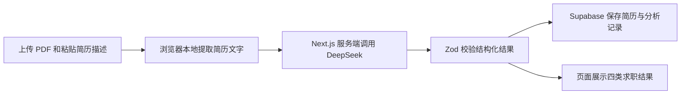

# 职达 AI · 求职助手

> 上传一份简历并填写简历描述，让 AI 帮你完成岗位匹配分析、简历优化、定向求职信和面试准备；2.0 在线简历页生成器可把经历变成可编辑、可切换主题、可公开分享的个人求职主页。

## 在线网站

网站通过 **Cloudflare Workers** 部署，线上域名以 Cloudflare 实际配置为准。

| 服务 | 用途 |
| --- | --- |
| **Cloudflare Workers** | 网站托管、Next.js 服务端渲染、Route Handlers 与静态资源分发 |
| **Supabase** | 邮箱登录、用户资料、PostgreSQL 数据库、RLS 数据隔离 |
| **DeepSeek** | 岗位分析、简历建议、求职信和面试问答生成 |
| **PDF.js** | 在浏览器本地提取 PDF 简历文字，不上传原 PDF |

---

## 已实现功能

### 求职者功能

- 上传文本型 PDF 简历，支持文件大小、页数和文字长度校验；
- 在浏览器中完成 PDF 文字提取，可查看提取结果；
- 填写简历描述，生成四类结果：
  1. 岗位匹配度、匹配优势与主要差距；
  2. 5–8 条具体简历优化建议；
  3. 一封针对岗位的求职信；
  4. 10 个面试问题、考察意图、参考回答和准备提示；
- 分项复制或复制完整报告；
- “使用流程”和“隐私说明”以卡片弹层展示，支持按钮、Esc 和遮罩关闭；
- 桌面端与移动端响应式界面，窄屏下保留两个独立说明入口。

### 在线简历页（2.0）

- 上传 PDF 或从历史分析选择简历，AI 结构化生成个人求职主页（定位、优势、项目、技能、联系方式、行动按钮）；
- AI 只输出结构化内容 JSON（Zod 校验），页面由站内组件渲染，不生成 HTML；
- 编辑器：分区表单 + 实时预览，条目增删排序、分区显隐；
- 8 种主题即点即换：清爽专业 / 产品主页风 / 创意作品集风 / 企业科技风 / 人物杂志风 / 职业时间轴 / 瑞士极简风 / 开发者文档；
- 发布获得公开链接 `/u/<slug>`，任何人无需登录即可访问；撤回/删除立即失效（动态渲染，无 CDN 缓存）；
- 游客可完整生成、编辑、预览（草稿存浏览器 localStorage）；仅发布/云端保存需登录，登录一次后草稿自动交接恢复；
- 登录用户草稿自动云保存（防抖 2 秒），每账户最多 10 个页面；
- 发布前弹窗确认将公开的联系方式；「清空保存数据」会级联删除全部简历页。

### 游客模式

- 无需注册或登录；
- 原 PDF 只在浏览器中解析，不上传到服务器；
- 提取的简历文字和用户填写的简历描述仅在点击分析后发送给本站服务端与 DeepSeek；
- 分析结果只保存在当前页面内存，刷新后清除；
- 不向 Supabase 写入求职数据。

### 登录模式

- 使用 Supabase Auth 邮箱注册、登录和退出；
- 首次登录访问时自动创建 `profiles` 用户资料；
- 用户自行决定是否开启“保存本次分析到历史”；
- 开启后保存简历解析文字、简历版本、简历描述、分析报告和 Token 用量；
- 查看历史报告列表与详情；
- 删除单条报告，或清空当前用户的全部保存数据；
- **当前不上传原 PDF，也不使用 Supabase Storage。**

---

## 技术栈

| 层级 | 技术 |
| --- | --- |
| 前端 | Next.js 16、React 19、TypeScript、原生 CSS、Lucide Icons |
| PDF 处理 | `pdfjs-dist` + Web Worker |
| 服务端 | Next.js App Router Route Handlers |
| AI 输出校验 | Zod + 自定义 JSON 结果契约 |
| 身份认证 | Supabase Auth + `@supabase/ssr` |
| 数据库 | Supabase PostgreSQL + Row Level Security |
| 部署 | Cloudflare Workers + OpenNext + Wrangler |

---

## 功能是如何实现的

### 1. 完整分析流程



### 2. PDF 在浏览器本地解析

`lib/pdf.ts` 使用 `pdfjs-dist` 按页读取 PDF 文本：

- 原文件不发送到 Next.js，也不发送到 Supabase；
- Worker 文件位于 `public/pdf.worker.min.mjs`；
- 检查加密、损坏、无文本层和扫描版 PDF；
- 当前限制为单文件 10 MB、最多 50 页、最多 30,000 个提取字符；
- 登录后保存的是**解析文字和文件元数据**，不是 PDF 文件本身。

### 3. DeepSeek 只在服务端调用

`app/api/analyze/route.ts` 负责：

- 校验简历文字和简历描述；
- 使用 System Prompt 约束模型不得编造经历、技能或量化成果；
- 使用服务端环境变量读取 API Key、接口地址、模型、超时和 Token 上限；
- 要求模型返回固定 JSON 结构；
- 使用 Zod 校验匹配分、建议数量和恰好 10 组面试问答；
- 对临时错误和格式错误进行有限重试；
- 将错误归一化为安全的错误码，不向上游日志写入简历正文。

所有 DeepSeek 配置均为必填环境变量，代码中没有真实接口地址、模型名或 API Key 的硬编码回退值。

### 4. Supabase Auth 与数据隔离

- `@supabase/ssr` 将登录会话保存在 Cookie 中；
- Next.js 16 的 `proxy.ts` 负责刷新会话；
- 服务端通过 `getClaims()` 验证用户，不信任未验证的客户端 Session；
- 所有业务表启用 RLS，用户只能访问自己的记录；
- 前端只使用 Supabase Publishable Key，不使用 Secret Key 或 Service Role Key；
- 保存接口仍需要有效的 Supabase 用户会话，游客保存请求会被拒绝。

### 5. AI 结果使用 JSONB 保存

当前不为每条建议或每道面试题单独建表，而是将完整报告保存在 `analysis_runs.result_json` 中：

- 匹配分单独保存为 `match_score`，便于历史列表查询；
- 分析记录关联具体的 `resume_version_id`，避免修改简历后历史内容对不上；
- 保存模型名、Prompt 版本和结果 Schema 版本，方便追踪兼容性问题；
- 将来需要逐条接受建议、面试作答或求职信多版本编辑时，再拆分子表。

### 6. Cloudflare Workers 部署方式

- `@opennextjs/cloudflare` 将 Next.js 应用构建为 Cloudflare Worker；
- `wrangler.jsonc` 配置 Worker 入口、静态资源目录和兼容性标志；
- 页面 SSR 与 Route Handlers 在 Workers 中运行，静态资源由 Workers Assets 提供；
- 项目全部页面与 API 采用动态渲染，不依赖 ISR，因此未配置 R2/KV 增量缓存；
- DeepSeek 密钥保存在 Cloudflare 环境变量或 Secret 中，不写入仓库；
- `NEXT_PUBLIC_` 变量在构建时注入前端，修改后需要重新构建并部署。

---

## 数据库结构

迁移文件：[supabase/migrations/20261119124922_career_core.sql](./supabase/migrations/20261119124922_career_core.sql)

| 表 | 用途 |
| --- | --- |
| `profiles` | 用户昵称、头像和语言偏好，关联 `auth.users`，不重复保存邮箱和密码 |
| `resumes` | 用户持续维护的简历主体 |
| `resume_versions` | 每次上传形成的简历版本、解析文字和文件元数据 |
| `job_posts` | 目标岗位名称、公司和完整简历描述 |
| `analysis_runs` | 分析状态、匹配分、完整 JSONB 报告、模型和 Prompt 版本 |
| `ai_usage_logs` | 每次 AI 调用的 Token 用量，不保存 Prompt、提取的简历文字或简历描述正文 |
| `resume_pages` | 在线简历页：slug、状态、主题、JSONB 内容快照；所有者全量管理，anon 仅可读已发布行 |

所有表均包含用户关联字段、时间戳、必要索引和 RLS 策略。2.0 迁移文件：[supabase/migrations/20261124103000_resume_pages.sql](./supabase/migrations/20261124103000_resume_pages.sql)。

---

## 本地开发

### 1. 安装依赖

```bash
npm install
```

### 2. 配置环境变量

```powershell
Copy-Item .env.example .env.local
```

编辑 `.env.local`，所有真实值只保存在本地，不要提交：

```dotenv
DEEPSEEK_API_KEY=your_api_key_here
DEEPSEEK_BASE_URL=your_base_url_here
DEEPSEEK_MODEL=your_model_name_here
DEEPSEEK_TIMEOUT_MS=your_timeout_ms_here
DEEPSEEK_MAX_TOKENS=your_max_tokens_here

NEXT_PUBLIC_SUPABASE_URL=your_supabase_project_url_here
NEXT_PUBLIC_SUPABASE_PUBLISHABLE_KEY=your_publishable_key_here
```

`.env.local` 已被 `.gitignore` 排除；`.env.example` 仅包含占位符。

### 3. 初始化 Supabase

需要 Supabase CLI 3.2+：

```bash
npx supabase@latest login
npx supabase@latest db query --remote=<your-project-ref> --file supabase/migrations/20261119124922_career_core.sql
```

在 Supabase **Authentication → URL Configuration** 中配置本地回调：

```text
http://localhost:3000/auth/confirm
http://localhost:3000/**
```

如果启用邮箱确认，注册后需要先在邮箱中完成验证。

### 4. 启动开发服务器

```bash
npm run dev
```

访问 [http://localhost:3000](http://localhost:3000)。

---

## 部署到 Cloudflare Workers

1. 安装依赖并登录 Cloudflare：

   ```bash
   npm install
   npx wrangler login
   ```

2. 按 `.env.example` 配置环境变量。DeepSeek 配置应保存在 Cloudflare Worker 的变量或 Secret 中；`NEXT_PUBLIC_` 变量会在构建时注入，本地构建前也需正确配置；
3. 通过 OpenNext 构建并部署：

   ```bash
   npm run deploy
   ```

   该命令会依次执行 `opennextjs-cloudflare build` 和 `opennextjs-cloudflare deploy`。本地预览 Cloudflare 版本可运行 `npm run preview`。

4. 部署完成后，将 Workers 域名或自定义域名加入 Supabase Auth 配置。

生产环境回调（替换为实际线上域名）：

```text
https://your-domain.example/auth/confirm
https://your-domain.example/**
```

Supabase Site URL 为：

```text
https://your-domain.example
```

修改环境变量后需要重新部署，尤其是构建时注入前端的 `NEXT_PUBLIC_` 变量。

---

## 主要目录

```text
app/
  api/analyze/             # DeepSeek 调用、结果校验、分析与用量持久化
  api/resumes/             # 简历文字和版本保存，不上传 PDF
  api/jobs/                # 简历描述保存
  api/history/             # 全部保存数据删除（含简历页级联删除）
  api/history/[id]/        # 单条报告删除
  api/pages/               # 简历页创建；generate 生成、sources 历史来源、slug-check
  api/pages/[id]/          # 简历页自动保存/删除；publish / unpublish
  auth/confirm/            # Supabase 邮箱验证回调
  history/                 # 历史报告列表与详情（含生成简历页入口）
  login/                   # 邮箱登录和注册
  pages/                   # 简历页列表、new 创建向导、draft 游客草稿、[id]/edit 编辑器
  u/[slug]/                # 公开简历页，SSR 动态渲染，无需登录
components/
  career-assistant.tsx     # 游客/登录双模式主流程
  results.tsx              # 四类 AI 结果展示
  auth-controls.tsx        # 登录入口、使用流程与隐私说明卡片
  site-header.tsx          # 响应式页头与导航
  auth-form.tsx            # Auth 表单
  history-list.tsx         # 历史列表
  pages/                   # 编辑器、创建向导、列表、游客草稿交接
  resume-page/             # 公开页渲染组件 + 8 主题 CSS
lib/
  supabase/                # Browser/Server Supabase 客户端
  analysis-schema.ts       # AI 输入输出 Zod 契约
  page-schema.ts           # 简历页内容契约、主题、slug 规则
  page-draft.ts            # 游客本地草稿（localStorage，24h 过期）
  deepseek.ts              # 共享 DeepSeek 客户端、限流、错误归一化
  pdf.ts                   # 浏览器端 PDF 提取
proxy.ts                   # Supabase 会话刷新
open-next.config.ts        # OpenNext Cloudflare 适配配置
wrangler.jsonc             # Cloudflare Worker、静态资源与兼容性配置
public/
  pdf.worker.min.mjs       # PDF.js Worker
supabase/migrations/       # 数据库、索引与 RLS 迁移
```

---

## 工程检查

```bash
npm run typecheck
npm run lint
npm run build
```

---

## 当前限制

- 仅支持文本型 PDF，暂不支持扫描件 OCR；
- AI 结果仅供求职准备参考，使用前应核对事实；
- 当前不创建 Supabase Storage，`resume_versions.storage_path` 仅为未来扩展预留；
- “清空保存数据”不删除 Supabase Auth 账户本身；
- 内存限流适合作为基础保护，多实例生产环境应使用平台或独立限流服务；
- 暂不支持逐条接受简历建议、面试作答记录和求职信多版本编辑；
- 简历页 MVP 暂不支持：头像/项目配图、访问统计、slug 修改重定向、自定义域名、页面密码保护、导出 PDF；
- 简历页编辑为 last-write-wins，双开标签页同时编辑同一页时后保存的覆盖先保存的。

原始产品需求见：[AI求职助手-需求文档.md](./AI求职助手-需求文档.md)。
